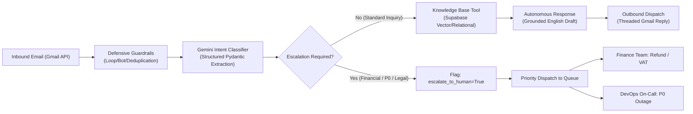

# CloudScale AI — Autonomous Customer Support & Triage Engine

[](https://fastapi.tiangolo.com)
[](https://ai.pydantic.dev)
[](https://supabase.com)
[](https://ai.google.dev)
[](https://react.dev)
[](https://www.typescriptlang.org)

An enterprise-ready, autonomous AI customer support orchestration platform designed for modern SaaS companies. Built with **Google Gemini**, **Pydantic AI**, **Supabase PostgreSQL**, and an interactive **React 19** administrative dashboard.

---

## 🏢 Platform Scenario: CloudScale AI
**CloudScale AI** is an enterprise B2B SaaS platform for cloud workflow automation, omnichannel CRM, and team orchestration. The system autonomously manages customer communications across five critical operations:
- **Product Tiers & Specifications:** Plan features, API throughput rates (Starter: 1,000 req/hr vs. Pro: 25,000 req/hr), storage quotas, and add-ons.
- **Digital License Provisioning & Invoicing:** Instant provisioning, Stripe processing, and reverse-charge VAT tax compliance.
- **14-Day Money-Back Guarantee:** Unconditional refund handling with seamless human escalation to finance.
- **Enterprise SLA & Infrastructure:** 99.95% uptime guarantees, automated 6-hour geo-redundant backups, and AES-256 encryption.
- **Developer FAQs & Troubleshooting:** Webhook debugging, HTTP 429 rate limit management, and migrations from Jira/Trello/Asana.

---

## 🏗️ Architecture & Pipeline Flow



1. **Autonomous Gmail Poller:** Queries inbox at configurable intervals (default: 30s) for unprocessed threads.
2. **Defensive Safety Guardrails:** Discards auto-replies (`X-Autoreply`, `Precedence: bulk`), bounces, and internal messages to eliminate infinite loops.
3. **Intent Classification:** Classifies inquiry topics into knowledge base sections, gauges sentiment, and produces a single-line summary.
4. **Agentic Knowledge Retrieval:** Queries the dynamic Supabase knowledge base (`fetch_knowledge_base`) to ground answers in verified company documentation.
5. **Deterministic Python Decision Engine:** Immediately routes refund payouts, tax invoices, and P0 outages to human specialists (`escalate_to_human=True`).
6. **Live React Dashboard:** Real-time visibility into customer tickets, raw inbound event streams, and live knowledge base markdown editing.

---

## 🚀 Quickstart Guide

### 1. Synchronize Dependencies
This project uses the modern, ultra-fast Python package manager `uv`:
```bash
uv sync
```

### 2. Seed the Knowledge Base
Populate the Supabase PostgreSQL database with the complete CloudScale AI documentation:
```bash
uv run python -m scripts.seed_kb
```

### 3. Launch Backend API & Admin Dashboard
Start the FastAPI server (serves both REST API and compiled React dashboard):
```bash
uv run uvicorn app.main:app --host 127.0.0.1 --port 8000 --reload
```
Navigate to your browser:
👉 **`http://localhost:8000`**

### 4. Start the Background Email Poller
In a separate terminal, initiate the continuous polling daemon:
```bash
uv run python -m app.poller
```

### 5. Run the Automated Benchmark Suite (Evals)
Verify classification accuracy and agent decision quality against the 12 golden test cases:
```bash
uv run python -m evals.run_evals
```

---

## 📁 Repository Structure

```
d:\customer-support-Agent\
├── app/
│   ├── config.py              # Environment configuration & settings
│   ├── db.py                  # Supabase client with resilient local fallback
│   ├── gmail.py               # Gmail API client, parser, and threaded sender
│   ├── guards.py              # Defensive safety guardrails & loop prevention
│   ├── pipeline.py            # End-to-end message processing & escalation logic
│   ├── poller.py              # Background worker daemon
│   ├── main.py                # FastAPI web server & static asset host
│   ├── ai/
│   │   ├── schemas.py         # Structured Pydantic outputs
│   │   ├── classifier.py      # Zero-shot intent & sentiment classifier
│   │   └── agent.py           # Grounded response agent with KB tools
│   └── knowledge_base/
│       └── sections/          # Official CloudScale AI markdown documentation
├── dashboard/                 # React 19 + TypeScript + Vite + Tailwind CSS
│   ├── src/
│   │   ├── App.tsx            # Full-featured executive admin interface
│   │   └── main.tsx
│   └── dist/                  # Compiled production static bundle
├── evals/
│   ├── golden_dataset.py      # 12 real-world enterprise SaaS benchmark cases
│   └── run_evals.py           # Automated evaluation runner
├── scripts/
│   ├── get_refresh_token.py   # Automated OAuth2 Gmail token generator
│   └── seed_kb.py             # Knowledge base database seeder
├── Dockerfile                 # Multi-stage production container
├── docker-compose.yml         # Containerized API + worker deployment
└── pyproject.toml
```

---

## 🌐 Switching Between Versions

This repository contains two dedicated versions:
- **International Version (English / CloudScale AI):** Active on branch `international`.
- **Persian Version (Farsi / CloudYar):** Preserved on branch `persian`.

To switch back to the Persian version:
```bash
git checkout persian
```
To return to the International version:
```bash
git checkout international
```
